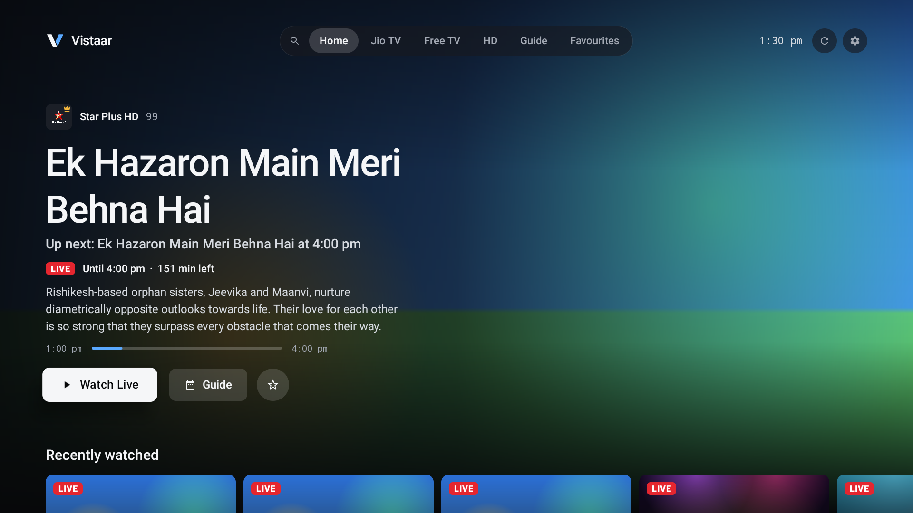
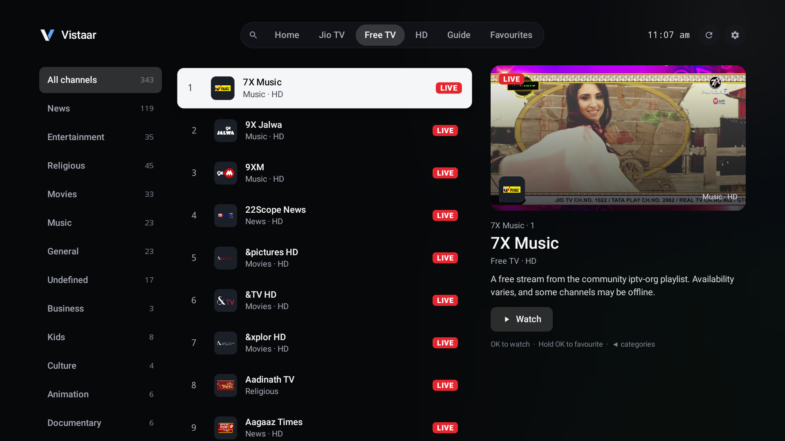
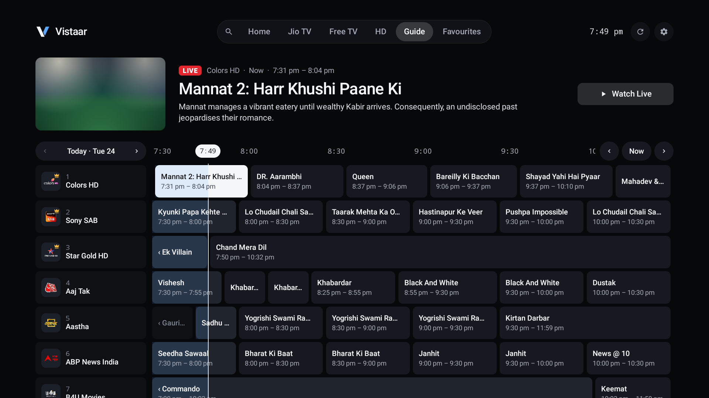

<div align="center">


# Vistaar

**Jio TV and free live channels on your TV, built for the remote.**

[](CHANGELOG.md)
[](LICENSE)
[](#android-tv--google-tv)
[](#lg-webos-beta)
[](#samsung-tizen-experimental)

[Download](#download) · [Install](#install) · [Features](#features) · [Changelog](CHANGELOG.md)

</div>

Vistaar is an **unofficial, independent client**. You can use the free channels without signing in, or sign in with your **own** Jio number to see the channels your plan includes. It is not affiliated with, endorsed by or supported by Jio.

## Download

| TV | Download (v0.4) |
|---|---|
| **Android TV / Google TV** | **[Vistaar-0.4-debug.apk](https://github.com/fortysev-en/vistaar/raw/v0.4/releases/Vistaar-0.4-debug.apk)** |
| **LG webOS** (Windows installer) | **[Vistaar-webOS-Installer-0.4.0.zip](https://github.com/fortysev-en/vistaar/raw/v0.4/releases/Vistaar-webOS-Installer-0.4.0.zip)** |
| **LG webOS** (app only) | [Vistaar-webOS-0.4.0.ipk](https://github.com/fortysev-en/vistaar/raw/v0.4/releases/Vistaar-webOS-0.4.0.ipk) |
| **Samsung Tizen** | **[Vistaar-Tizen-0.4.0.wgt](https://github.com/fortysev-en/vistaar/raw/v0.4/releases/Vistaar-Tizen-0.4.0.wgt)** |

<details>
<summary>SHA-256 checksums</summary>

| File | SHA-256 |
|---|---|
| `Vistaar-0.4-debug.apk` | `E98F4382659A97BA5210BA950A381026D056B58FF961AE94DC69D8812432A761` |
| `Vistaar-webOS-Installer-0.4.0.zip` | `9F9F97E2C50D7D3DDB4D09FA06CBF4B2CFE935B4A32A00DC875E2F1A613F246E` |
| `Vistaar-webOS-0.4.0.ipk` | `7EA0A62B380AFBAAC362E69B0D99CAE995F40815BCC12D323C7CFA5D007D4ACD` |
| `Vistaar-Tizen-0.4.0.wgt` | `E07F2BA63C372FCC6DE2F4C0E365FEFB6F9EF7EC9FA9DD8D04645F18C08399E2` |

</details>

## Install

### Android TV / Google TV

1. Download the **APK** and copy it to the TV (USB drive, or an app such as *Downloader*).
2. Open it and choose **Install**. Allow *install unknown apps* if asked.
3. Open **Vistaar** from the app list.

From a computer: turn on network debugging on the TV, then run `adb connect <TV-IP>:5555` and `adb install -r Vistaar-0.4-debug.apk`. Installing over an older version keeps your sign-in and favourites. The APK is signed with the Android debug key and is not a Play Store build.

### LG webOS (beta)

For 2020 TVs and newer.

1. On the TV, install **Developer Mode** from the LG Content Store and sign in with a free LG developer account. Turn **Dev Mode Status** and **Key Server** ON, and note the TV's **IP address** and **passphrase**.
2. On a Windows computer on the same network, download the **installer zip** and unzip it.
3. Run **`Install Vistaar.bat`**, enter the IP address and passphrase, and wait for "Done!".

Developer Mode needs an **Extend** every few weeks (`Extend Developer Mode.bat` does it). Some DRM-protected Jio channels don't play on webOS yet. Troubleshooting and Mac/Linux steps: **[docs/webos-install.md](docs/webos-install.md)**.

### Samsung Tizen (experimental)

For 2020 TVs and newer. You only need an **Android phone**, no computer.

1. On the TV, open **Apps**, type **12345** on the remote, turn **Developer mode** ON and enter your **phone's IP address**. Then switch the TV fully off and on (hold the power button for 2 seconds).
2. On the phone, on the same Wi-Fi, install **[Apps2Samsung](https://github.com/Apps2Samsung/Apps2Samsung)**.
3. Download the **`.wgt`** file to the phone.
4. In Apps2Samsung, connect to the TV (its IP address is under Settings, General, Network, Network Status), choose the `.wgt` and install it.
5. Open **Vistaar** from the TV's app list. Keep Developer mode on, or the app is removed.

Apps2Samsung is a separate project, not made or checked by Vistaar. Jio's encrypted channels are untested on Tizen. More detail: **[docs/tizen-install.md](docs/tizen-install.md)**.

## Features

- **Free TV** from the community [iptv-org](https://github.com/iptv-org/iptv) playlist, with no sign-in. You can switch to another country or your own M3U link.
- **Jio TV** with your own account: only the channels your plan includes, browsed by genre or language.
- **Home made for you**: recently watched, favourites, then rows for the categories you pick.
- **Programme guide** as a time grid, for Jio channels.
- **Favourites**, **Search** and an **HD** tab.
- **Your layout**: hold OK to rearrange the top tabs and categories. The app opens on your first tab.
- **Player** with a guide overlay, quality, audio track and aspect controls.
- **Phone remote** (Android TV only): use your phone as the remote and keyboard on the same Wi-Fi.

## Screenshots

| Home | Jio TV |
|---|---|
|  |  |

| Free TV | Guide |
|---|---|
|  |  |

## Remote

| Button | What it does |
|---|---|
| **OK** | Open or play. In the player, show the controls. |
| **Hold OK** | On a channel: add or remove a favourite. On a top tab or category: move it, then press OK to drop it. |
| **Up / Down** in the player | Show the guide; press again to change channel. |
| **CH + / -** | Change channel straight away. |
| **Back** | Go back. On Home it asks before exiting. |

## Good to know

- Free channels come and go. Some are offline, region-locked or have no audio.
- Which Jio channels you see depends on your plan.
- Vistaar is not on any TV app store.

## Build from source

**Android TV** (JDK 17 and Android SDK 34; set `sdk.dir` in `local.properties`):

```bash
./gradlew assembleDebug        # Windows: gradlew.bat assembleDebug
```

**LG webOS** and **Samsung Tizen** (Node.js; both use the web app in `web/`):

```bash
cd web && npm install
cd ../webos && npm install && npm run package
cd ../tizen && npm run package
```

The Android app is in `app/`, the shared web app in `web/`, the platform packaging in `webos/` and `tizen/`, and the Windows installer builder in `installer/`.

## Legal

- Use Vistaar only with a Jio account you are entitled to use.
- It does **not** bypass payment, plan checks or DRM. Channels outside your plan stay hidden.
- Free channels come from the third-party iptv-org project and belong to their broadcasters. Vistaar does not host or control them.
- Jio, JioTV, channel names, logos and programme titles belong to their owners.
- Provided as is, with no warranty.

## License

The source code is under the [MIT License](LICENSE). The licence does not cover Jio, channel names, logos or streams, nor the [fortyseven](https://fortyseven.dev) studio mark.

Third-party components keep their own licences: AndroidX Media3, OkHttp and AndroidX (Apache-2.0), hls.js (Apache-2.0), and the iptv-org playlists (Unlicense).
