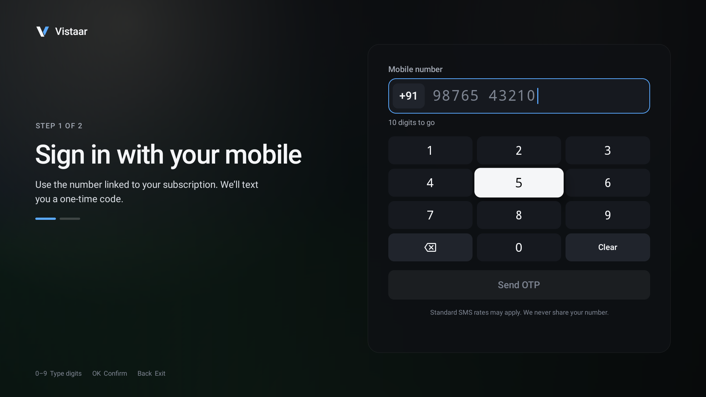
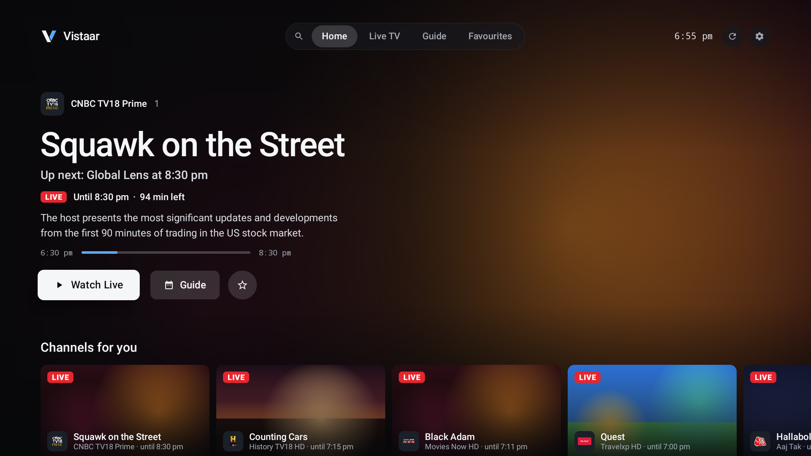
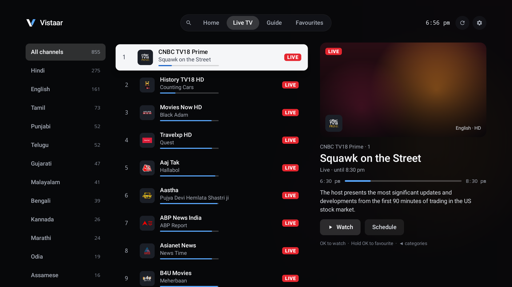
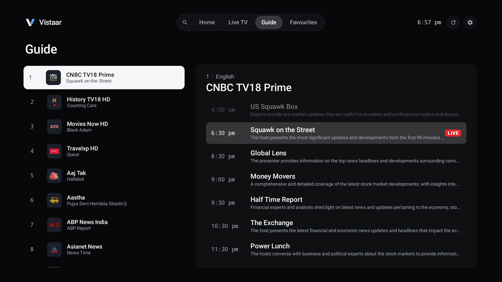
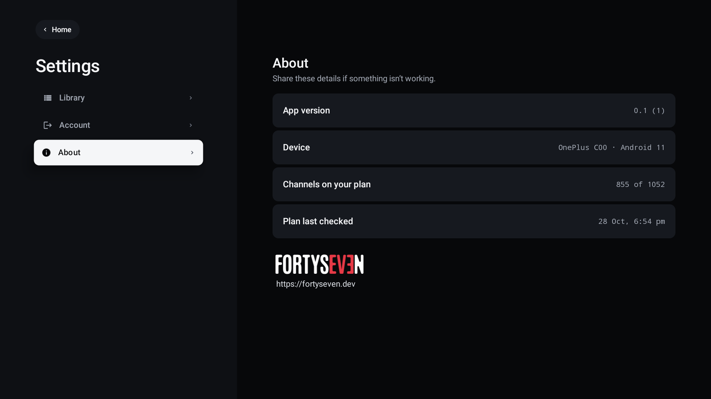

# Vistaar

A Live TV app for Android TV, built for the remote: browse channels by language, check what's on now and next, keep favourites, and watch, all from the couch.

Vistaar is an **unofficial, independent client**. You sign in with your **own** Jio mobile number and one-time code, and it shows the channels that account is entitled to. It is not affiliated with, endorsed by or supported by Jio or its owners.

| Sign in | Home |
|---|---|
|  |  |

| Live TV | Guide |
|---|---|
|  |  |

| About |
|---|
|  |

## Contents

- [Features](#features)
- [Download and install](#download-and-install)
- [Using the app](#using-the-app)
- [Build from source](#build-from-source)
- [Project layout](#project-layout)
- [How it works](#how-it-works)
- [Known limits](#known-limits)
- [Legal](#legal)

## Features

- **Sign in with a number and a code**, using an on-screen keypad (or the remote's number keys). You stay signed in until you sign out.
- **Only what you can watch.** On first launch the app checks every channel against your account and lists only the ones your plan includes. The result is remembered for 6 hours; use **Refresh** to re-check.
- **Home**: a hero for what you watched last, with the current programme, time left, description and progress; rows for recently watched, favourites and languages.
- **Live TV**: languages on the left, channels in the middle (with the programme on now), a preview panel on the right.
- **Guide**: pick a channel and see today's programmes.
- **Search**: an on-screen keyboard that works with any remote, and recent searches.
- **Favourites**: hold OK on any channel to save it; sort and edit mode on its own screen.
- **Player**: channel up/down, quality (Auto or a fixed resolution), audio track, aspect (Fit, Zoom, Stretch), favourite, and a guide shortcut. The overlay hides itself after a few seconds.
- **Settings**: refresh channels, clear favourites or history, sign out, app and device details.
- **Refresh** button in the header on every screen (it spins while it re-checks your plan).
- Designed for 1920×1080 and scales to other TV resolutions.

## Download and install

The ready-to-install APK is in this repository:

**[`releases/Vistaar-0.1-debug.apk`](releases/Vistaar-0.1-debug.apk)**

- Version: 0.1 (build 1)
- Package: `com.vistaar.tv`
- Needs: Android TV / Google TV with Android 6.0 (API 23) or newer
- SHA-256: `E349161EC2FA2946A0DFD95AFAC28D186677868363F34ED00A084273298C8054`

It is signed with the standard Android **debug key**, which is fine for installing on your own TV but is not a Play Store build.

### Option 1: install from a USB drive or the TV's browser

1. Copy `Vistaar-0.1-debug.apk` to a USB drive and plug it into the TV, or put it somewhere the TV can download it.
2. Use a file manager app on the TV (or an app such as *Downloader*) to open the file.
3. When asked, allow that app to **install unknown apps**, then choose **Install**.
4. Open **Vistaar** from the TV's app list.

### Option 2: install with ADB (from a computer)

1. On the TV open **Settings → Device Preferences → About** and tap **Build** seven times to enable Developer options.
2. Open **Developer options** and turn on **USB debugging** (on some TVs it is called **ADB debugging** or **Network debugging**).
3. Find the TV's IP address under **Settings → Network & Internet**.
4. On your computer, with [Android platform-tools](https://developer.android.com/tools/releases/platform-tools) installed:

   ```bash
   adb connect <TV-IP>:5555
   adb install -r releases/Vistaar-0.1-debug.apk
   ```

5. The first time you connect, the TV asks you to allow the computer. Choose **Always allow** and **Allow**, then run the install command again if it said "unauthorized".
6. Open **Vistaar** from the TV's app list.

### Updating

Install a newer APK over the old one with `adb install -r ...`. Your sign-in and favourites are kept as long as the package name stays the same and the APKs share a signing key.

## Using the app

| Remote | What it does |
|---|---|
| **D-pad** | Move focus. The focused item turns white. |
| **OK** | Open or play. In the player, with the overlay hidden, it shows the controls. |
| **Hold OK** on a channel | Add or remove it from favourites. |
| **Up / Down** in the player | Next or previous channel (also the channel keys, if your remote has them). |
| **Back** | Hide the overlay, then leave the player. On Home it asks before exiting. |
| **Number keys** | Type digits on the sign-in screen. |

## Build from source

You need:

- **JDK 17**
- **Android SDK** with Platform 34 and Build-Tools 34 (installing Android Studio is the easiest way)
- Internet access on the first build (Gradle and dependencies are downloaded)

1. Create `local.properties` in the project root, pointing at your SDK (it is git-ignored):

   ```properties
   sdk.dir=C\:\\Users\\<you>\\AppData\\Local\\Android\\Sdk
   ```

   On macOS or Linux: `sdk.dir=/Users/<you>/Library/Android/sdk` or `sdk.dir=/home/<you>/Android/Sdk`.

2. Build the debug APK:

   ```bash
   ./gradlew assembleDebug        # Windows: gradlew.bat assembleDebug
   ```

3. The APK is written to `app/build/outputs/apk/debug/app-debug.apk`.

You can also open the folder in Android Studio and run it on a TV emulator or a connected TV.

Dependencies: AndroidX Media3 1.3.1 (ExoPlayer with HLS and DASH), OkHttp 4.12, AndroidX RecyclerView. Kotlin 1.9, Android Gradle Plugin 8.5.

## Project layout

```
app/src/main/
├── AndroidManifest.xml
├── java/com/vistaar/tv/
│   ├── Api.kt              Network calls: sign-in, channel list, programme guide, stream URL, session storage
│   ├── Catalog.kt          Channel list, "which channels does this account get", favourites, recents, programme cache
│   ├── Theme.kt            Design system: colours, focus states, artwork, header, cards, dialogs
│   ├── Design.kt           Image loader and small shared helpers
│   ├── LoginActivity.kt    Mobile number and OTP screens
│   ├── HomeActivity.kt     Hero and rows
│   ├── LiveTvActivity.kt   Categories, channel list, preview
│   ├── GuideActivity.kt    Programme guide
│   ├── SearchActivity.kt   On-screen keyboard search
│   ├── FavoritesActivity.kt
│   ├── SettingsActivity.kt Library, account, about
│   ├── PlayerActivity.kt   Playback, overlay, quality/audio panel, error card
│   └── PlaylistFix.kt      HLS playlist workaround (see below)
└── res/                    Icons, TV banner, wordmark, vector icons
releases/                   Built APK
docs/screenshots/           README images
```

## How it works

- **Sign in.** The app sends your number to Jio's sign-in service, which texts you a code; the code is verified and the session tokens it returns are stored on the TV, in the app's private storage.
- **Channel list and "your plan".** The app downloads the full channel list, then asks for each channel's stream the same way a playback request would. Channels that return a stream are the ones your account can watch; the rest (for example premium channels outside your plan) are hidden. This takes a minute or two on first launch.
- **Programme data.** Today's schedule per channel comes from Jio's guide service and is cached for two minutes.
- **Playback.** Streams are played with ExoPlayer. Most channels are HLS; DASH channels use the TV's Widevine DRM. Two details matter: the stream host hands out a cookie that must be replayed on later requests, and the master playlists advertise I-frame (trick-play) playlists that the server refuses, which would stop playback, so `PlaylistFix.kt` removes those lines before parsing.
- **The design.** The interface follows the "Vistaar" design board (a dark, white-focus system with a blue accent), scaled from a 1920×1080 canvas.

## Known limits

- **Plan-gated channels.** About 195 of roughly 1,050 channels were refused for the account this was built and tested with, and are therefore hidden. A different account will see a different list.
- **No token refresh.** If the session expires, sign in again.
- **Stream tokens expire.** The player reconnects up to twice on an error, then shows a retry card.
- **Artwork is generated.** The service provides no programme stills, so cards use gradient artwork chosen per channel.
- **Language names** (Hindi, English, Tamil and so on) are mapped from Jio's numeric language ids using public knowledge, not from official data. An unknown id shows as "Other".
- **Untested areas.** Search with real input, the favourites grid in edit mode, DRM channels on every TV model, and most error states have had limited testing. It was tested on one Android 11 TV.
- **Debug signing and no automated tests.**
- **Not on the Play Store**, and not intended for it.

## Legal

- Vistaar is a personal project for use with **your own subscription**. Use it only with an account you are entitled to use.
- It does **not** bypass payment, plan checks or DRM: channels outside your plan stay hidden, and protected streams are played through the TV's own Widevine.
- Jio, JioTV and related names and logos belong to their owners. Channel names, logos and programme titles shown in the screenshots belong to their broadcasters.
- Provided as is, with no warranty.

## Credits

- Interface, logo (the "Blade V" mark), app icon and TV banner: the Vistaar brand board.
- Studio mark on the About screen: fortyseven, <https://fortyseven.dev>.

## License

No license has been chosen yet. Until one is added, all rights are reserved by the author; add a `LICENSE` file before inviting contributions.
