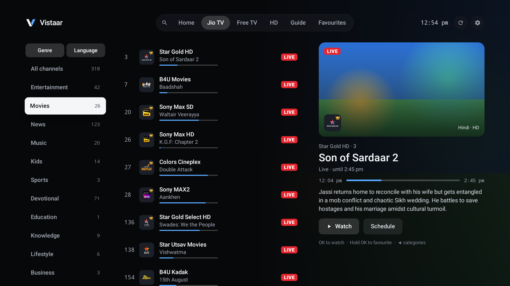
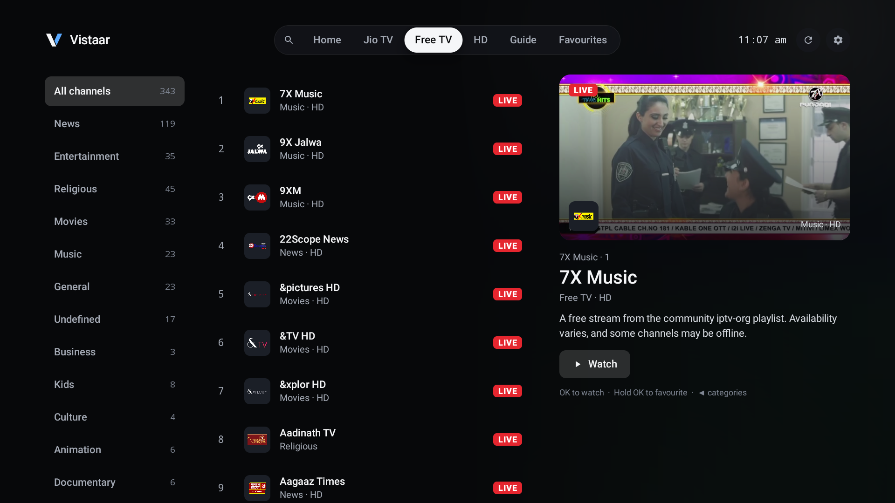
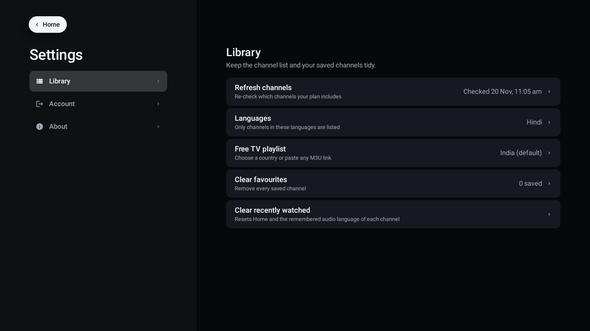
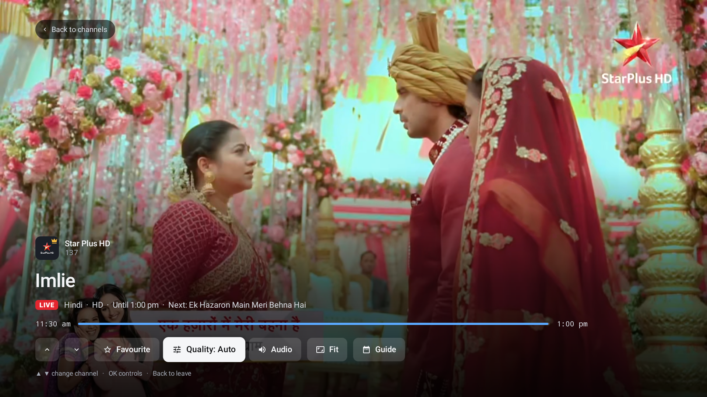
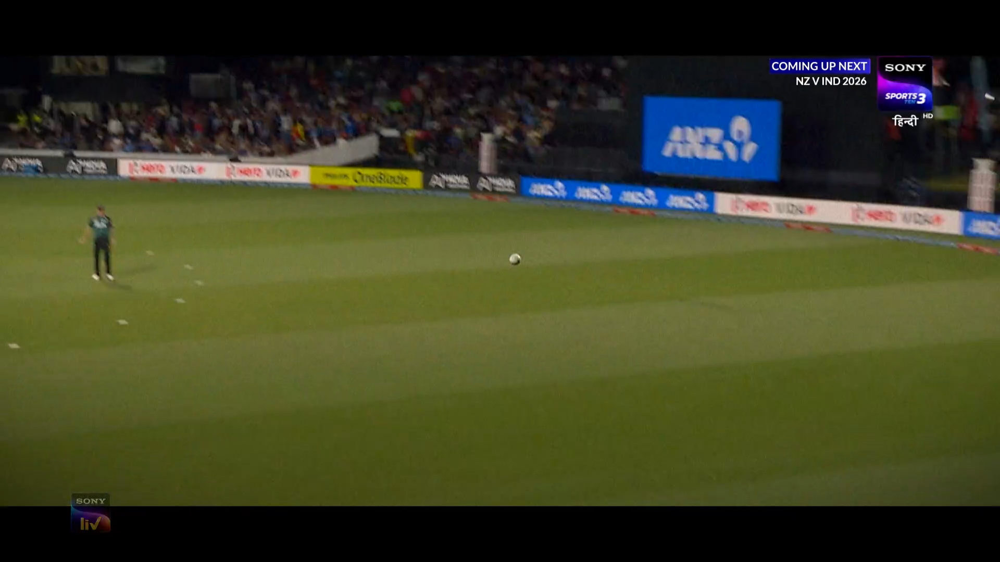
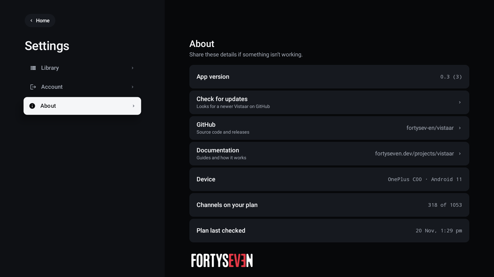
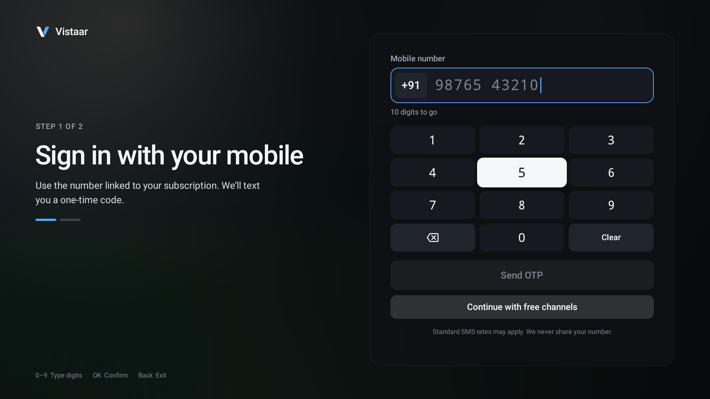

<div align="center">


# Vistaar

**Jio TV and free live channels for Android TV and LG webOS, built for the remote.**

[](CHANGELOG.md)
[](LICENSE)
[](#download-and-install)
[](docs/webos-install.md)

[Download](#download-and-install) · [Features](#features) · [Changelog](#changelog) · [LG webOS](docs/webos-install.md)

</div>

Browse channels by language, check what's on now and next, keep favourites, and watch, all from the couch.

Vistaar is an **unofficial, independent client**. You sign in with your **own** Jio mobile number and one-time code, and it shows the channels that account is entitled to. It is not affiliated with, endorsed by or supported by Jio or its owners. You can also skip Jio and use only the free channels.

## Screenshots

Captured from the 0.3 app on an Android TV (1920×1080).

| Home | Jio TV |
|---|---|
|  |  |

| Free TV | HD |
|---|---|
|  |  |

| Guide | Settings |
|---|---|
|  |  |

| Star Plus HD (premium crown, guide, controls) | Sony Sports Ten 3 Hindi (free channel) |
|---|---|
|  |  |

| About | Sign in |
|---|---|
|  |  |

## Contents

- [Features](#features)
- [Download and install](#download-and-install)
- [Using the app](#using-the-app)
- [Build from source](#build-from-source)
- [Project layout](#project-layout)
- [How it works](#how-it-works)
- [Known limits](#known-limits)
- [Changelog](#changelog)
- [Legal](#legal)
- [License](#license)

## Features

- **Sign in with a number and a code**, using an on-screen keypad (or the remote's number keys). You stay signed in until you sign out.
- **Premium crown.** Channels outside the base pack (for example the Star channels) carry a small gold crown.
- **Only what you can watch.** On first launch the app checks every channel against your account and lists only the ones your plan includes. The result is remembered for 6 hours; channels it had refused are re-tried quietly after 10 minutes (so a new channel pack shows up on its own), and **Refresh** re-checks everything.
- **Home**: a hero for what you watched last, with the current programme, time left, description and progress; rows for recently watched, favourites and languages.
- **Jio TV**: languages on the left, channels in the middle (with the programme on now), a preview panel on the right.
- **Free TV**: a separate tab with the free Indian channels from the community [iptv-org](https://github.com/iptv-org/iptv) playlist (about 850, grouped by category such as News, Movies and Music). They play in the same player, can be favourited, show on Home and turn up in search. No sign-in is needed for the streams themselves, but many are offline at any given time.
- **HD**: every HD channel in one place, from your Jio plan and from the free list, split into Jio TV and Free TV.
- **Free-only mode**: on the sign-in screen, *Continue with free channels* skips Jio completely; add Jio later from Settings.
- **Languages**: on first run you pick the languages you watch (several allowed); only those Jio channels are listed and checked first. Change it in Settings.
- **Genres**: Jio TV can be browsed by Genre (Entertainment, Movies, News, Music, Kids, Sports and more) or by Language.
- **Live preview**: the panel on the right plays a muted live picture of the focused channel after a short pause.
- **Remembered audio**: the audio language you pick on a channel is used the next time you watch it.
- **Your own playlist**: Settings → Free TV playlist switches the free list to another country or any M3U link (India by default).
- **Updates**: the app checks GitHub for a newer release and offers to install it (also in Settings → About).
- **Device limit**: if Jio says the account is on too many devices, the sign-in offers to log out the other devices and finishes signing in. *Sign out* in Settings now also tells Jio, so this TV stops counting against the limit.
- **Guide**: pick a channel and see today's programmes.
- **Search**: an on-screen keyboard that works with any remote, and recent searches.
- **Favourites**: hold OK on any channel to save it; sort and edit mode on its own screen.
- **Player**: channel up/down, quality (Auto or a fixed resolution), audio track, aspect (Fit, Zoom, Stretch), favourite, and a guide shortcut. The overlay hides itself after a few seconds.
- **Settings**: refresh channels, clear favourites or history, sign out, app and device details.
- **Refresh** button in the header on every screen (it spins while it re-checks your plan).
- Designed for 1920×1080 and scales to other TV resolutions.

## Download and install

### Android TV / Google TV

1. Download **[`Vistaar-0.3-debug.apk`](releases/Vistaar-0.3-debug.apk)** (Android 6.0 or newer).
2. Copy it to the TV (USB drive, or an app such as *Downloader*), open it and choose **Install**. Allow *install unknown apps* if asked.
3. Open **Vistaar** from the app list.

Prefer a computer? Turn on USB/network debugging on the TV, then run `adb connect <TV-IP>:5555` and `adb install -r Vistaar-0.3-debug.apk`.

SHA-256: `D93A6F4B2E9EE74BD1C58FAEFAFF2C79A79D674FE396ED23E906930FCE3E3E8`. The APK is signed with the Android debug key, so it is for your own TV and not a Play Store build. To update, install a newer APK over the old one; your sign-in and favourites are kept.

### LG webOS (beta, 2020 TVs and newer)

1. On the TV, install **Developer Mode** from the LG Content Store, sign in with a free LG developer account, turn **Dev Mode Status** and **Key Server** ON (leave *Clear Cache Data* OFF), and note the TV's **IP address** and **passphrase**.
2. On a Windows computer on the same network, download **[`Vistaar-webOS-Installer.zip`](releases/Vistaar-webOS-Installer.zip)** and unzip it.
3. Run **`Install Vistaar.bat`**, type the IP address and passphrase, and wait for "Done!".

Developer Mode needs an **Extend** every few weeks (`Extend Developer Mode.bat` does it). Full steps, troubleshooting and manual commands for Mac/Linux: **[docs/webos-install.md](docs/webos-install.md)**. A few DRM-protected Jio channels are not supported on webOS yet.

SHA-256 of the zip: `8C4BFAD743C6A733C6569FBF8C8EF245FE72D91C9B798A8072B5E773517C10A0`.

## Using the app

| Remote | What it does |
|---|---|
| **D-pad** | Move focus. The focused item turns white. |
| **OK** | Open or play. In the player, with the overlay hidden, it shows the controls. |
| **Hold OK** on a channel | Add or remove it from favourites. |
| **Up / Down** in the player | Next or previous channel (also the channel keys, if your remote has them). |
| **Back** | Hide the overlay, then leave the player. On Home it asks before exiting. |
| **Number keys** | Type digits on the sign-in screen. |

## Build from source

You need:

- **JDK 17**
- **Android SDK** with Platform 34 and Build-Tools 34 (installing Android Studio is the easiest way)
- Internet access on the first build (Gradle and dependencies are downloaded)

1. Create `local.properties` in the project root, pointing at your SDK (it is git-ignored):

   ```properties
   sdk.dir=C\:\\Users\\<you>\\AppData\\Local\\Android\\Sdk
   ```

   On macOS or Linux: `sdk.dir=/Users/<you>/Library/Android/sdk` or `sdk.dir=/home/<you>/Android/Sdk`.

2. Build the debug APK:

   ```bash
   ./gradlew assembleDebug        # Windows: gradlew.bat assembleDebug
   ```

3. The APK is written to `app/build/outputs/apk/debug/app-debug.apk`.

You can also open the folder in Android Studio and run it on a TV emulator or a connected TV.

Dependencies: AndroidX Media3 1.3.1 (ExoPlayer with HLS and DASH), OkHttp 4.12, AndroidX RecyclerView. Kotlin 1.9, Android Gradle Plugin 8.5.

## Project layout

```
app/src/main/
├── AndroidManifest.xml
├── java/com/vistaar/tv/
│   ├── Api.kt              Network calls: sign-in, channel list, programme guide, stream URL, session storage
│   ├── Catalog.kt          Channel list, "which channels does this account get", favourites, recents, programme cache
│   ├── Theme.kt            Design system: colours, focus states, artwork, header, cards, dialogs
│   ├── Design.kt           Image loader and small shared helpers
│   ├── LoginActivity.kt    Mobile number and OTP screens
│   ├── HomeActivity.kt     Hero and rows
│   ├── LiveTvActivity.kt   Categories, channel list, preview
│   ├── FreeTvActivity.kt   Same layout for the free iptv-org channels
│   ├── HdTvActivity.kt     The HD tab (same screen, HD channels only)
│   ├── Free.kt             Downloads and parses the free playlist (iptv-org India by default)
│   ├── Streams.kt          How a channel's stream is looked up and played (player and preview share it)
│   ├── PreviewPlayer.kt    Muted live picture in the Jio TV / Free TV preview panel
│   ├── LanguageActivity.kt First-run language choice
│   ├── PlaylistActivity.kt Free TV playlist picker and link keyboard
│   ├── Updater.kt          GitHub release check and installer hand-off
│   ├── GuideActivity.kt    Programme guide
│   ├── SearchActivity.kt   On-screen keyboard search
│   ├── FavoritesActivity.kt
│   ├── SettingsActivity.kt Library, account, about
│   ├── PlayerActivity.kt   Playback, overlay, quality/audio panel, error card
│   └── PlaylistFix.kt      HLS playlist workaround (see below)
└── res/                    Icons, TV banner, wordmark, vector icons
releases/                   Built APK
web/                        Platform-neutral web app (TypeScript) used by the LG webOS build
webos/                      LG webOS packaging: appinfo, helper service for stream keys, .ipk output
webos-probe/                Small compatibility test app for real LG TVs
installer/                  Builds the Windows one-click installer for the LG app
docs/screenshots/           README images
```

## How it works

- **Sign in.** The app sends your number to Jio's sign-in service, which texts you a code; the code is verified and the session tokens it returns are stored on the TV, in the app's private storage.
- **Channel list and "your plan".** The app downloads the full channel list, then asks for each channel's stream the same way a playback request would. Channels that return a stream are the ones your account can watch; the rest (for example premium channels outside your plan) are hidden. This takes a minute or two on first launch.
- **Free TV.** The India playlist (`https://iptv-org.github.io/iptv/countries/in.m3u`) is downloaded, cached for 6 hours and parsed into channels. Their streams are played directly with their own user agent and referrer where the playlist gives one; your Jio sign-in tokens are never sent to them. Free channels have no programme guide.
- **Programme data.** Today's schedule per channel comes from Jio's guide service and is cached for two minutes.
- **Playback.** Streams are played with ExoPlayer. While you watch, the next and previous channel are looked up in the background, so changing channel starts in well under a second.
- **Playback (details).** Streams are played with ExoPlayer. Most channels are HLS; DASH channels use the TV's Widevine DRM. Two details matter: the stream host hands out a cookie that must be replayed on later requests, and the master playlists advertise I-frame (trick-play) playlists that the server refuses, which would stop playback, so `PlaylistFix.kt` removes those lines before parsing.
- **The design.** The interface follows the "Vistaar" design board (a dark, white-focus system with a blue accent), scaled from a 1920×1080 canvas.

## Known limits

- **Plan-gated channels.** About 195 of roughly 1,050 channels were refused for the account this was built and tested with, and are therefore hidden. A different account will see a different list.
- **Free channels are not vetted.** The iptv-org list is community-maintained; links come and go, some are geo-blocked, and DRM-protected or YouTube-only entries are skipped or fail to play. Cleartext (`http://`) streams are allowed for this reason.
- **Sessions.** When Jio answers 419 (access token expired) the app swaps the refresh token for a new one and retries. If that is rejected too, sign in again. Channels the server answers with "No eligible plans" are hidden; that depends on your Jio plan, not on the app.
- **Stream tokens expire.** The player reconnects up to twice on an error, then shows a retry card.
- **Artwork is generated.** The service provides no programme stills, so cards use gradient artwork chosen per channel.
- **Language names** (Hindi, English, Tamil and so on) are mapped from Jio's numeric language ids using public knowledge, not from official data. An unknown id shows as "Other".
- **Untested areas.** Search with real input, the favourites grid in edit mode, DRM channels on every TV model, and most error states have had limited testing. It was tested on one Android 11 TV.
- **Debug signing and no automated tests.**
- **Updates.** The in-app updater needs each GitHub release to carry the APK, and only installs over the existing app when both are signed with the same key.
- **Free TV and languages.** The free playlist has no language information, so the language choice is applied using iptv-org's per-language lists; free channels that are in none of them are hidden while a language is chosen. Choose *All languages* to see everything.
- **Not on the Play Store**, and not intended for it.

## Changelog

Latest releases (full history in [CHANGELOG.md](CHANGELOG.md)):

| Version | Date | Highlights |
|---|---|---|
| **0.3** (build 3) | 2026-11-20 | LG webOS beta; premium crown; guide for free channels that are also on Jio; plan re-check; language and genre browsing; live preview; free-only mode; custom Free TV playlist; device-limit logout; in-app updates; "Live TV" renamed **Jio TV** |
| **0.2** (build 2) | 2026-11-02 | Free TV and HD tabs; faster channel changes; steadier category focus; token refresh on HTTP 419 |
| **0.1** (build 1) | 2026-10-28 | First release |

## Legal

- Vistaar is a personal project for use with **your own subscription**. Use it only with an account you are entitled to use.
- It does **not** bypass payment, plan checks or DRM: channels outside your plan stay hidden, and protected streams are played through the TV's own Widevine.
- The Free TV channels come from the third-party iptv-org project and belong to their broadcasters; Vistaar does not host or control them.
- Jio, JioTV and related names and logos belong to their owners. Channel names, logos and programme titles shown in the screenshots belong to their broadcasters.
- Provided as is, with no warranty.

## Credits

- Interface, logo (the "Blade V" mark), app icon and TV banner: the Vistaar brand board.
- Studio mark on the About screen: fortyseven, <https://fortyseven.dev>.

## License

Vistaar is released under the [MIT License](LICENSE). The licence covers the source code in this repository. It does not cover Jio, JioTV, channel names, logos or streams, which belong to their owners, nor the fortyseven studio mark, which belongs to fortyseven.

Third-party components keep their own licences: AndroidX Media3, OkHttp and AndroidX (Apache-2.0), hls.js (Apache-2.0), and the iptv-org playlists (Unlicense).
